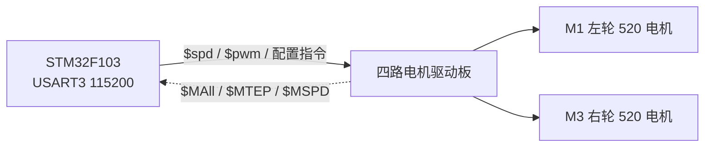

# Mini STM32 平衡车（串口四路驱动板版）

基于 STM32F103xB 的小车工程。原方案由 STM32 直接输出 PWM 并读取编码器，现改为**通过 USART3 控制一块四路串口电机驱动板**：驱动板内部完成 PWM 输出、编码器采集和速度 PID，STM32 只负责下发指令、读取反馈。



## 硬件连接

| STM32F103 | 驱动板 | 说明 |
| --- | --- | --- |
| `PB10` (USART3_TX) | `RX` | 交叉连接 |
| `PB11` (USART3_RX) | `TX` | 交叉连接 |
| `GND` | `GND` | 必须共地 |
| — | `VM` | 电池供电，禁止用 3.3V 驱动电机 |

- 电机通道：`M1` = 左轮，`M3` = 右轮，`M2/M4` 未使用
- 电机类型：520 编码器电机
- 串口参数：`115200`、8 数据位、无校验、1 停止位、无流控

### B570 原板引脚分配（参考）

以下引脚来自 WHEELTEC B570 资源分配表与原理图。**当前工程只使用 USART3（PB10/PB11）连接四路串口驱动板，其余外设暂未配置。**

| 引脚 | 功能 | 原外设 / 说明 | 当前状态 |
| --- | --- | --- | --- |
| `PB10` / `PB11` | 蓝牙模块串口 | USART3 | ✅ 已改作四路驱动板串口 |
| `PA9` / `PA10` | MicroUSB 串口 | USART1（CH340） | ⏳ 暂未配置 |
| `PA4` | LED | GPIO | ⏳ 暂未配置 |
| `PA5` | 用户按键 | GPIO | ⏳ 暂未配置 |
| `PA15` | OLED DC | GPIO | ⏳ 暂未配置 |
| `PB3` | OLED RES | GPIO | ⏳ 暂未配置 |
| `PB4` | OLED SDA | GPIO | ⏳ 暂未配置 |
| `PB5` | OLED SCL | GPIO | ⏳ 暂未配置 |
| `PA12` | MPU6050 INT | EXTI | ⏳ 暂未配置 |
| `PB8` / `PB9` | MPU6050 软件 IIC | SCL / SDA | ⏳ 暂未配置 |
| `PA0` / `PA1` | 左轮编码器 | TIM2_CH1 / TIM2_CH2 | ⏳ 暂未配置（现由驱动板采集） |
| `PB6` / `PB7` | 右轮编码器 | TIM4_CH1 / TIM4_CH2 | ⏳ 暂未配置（现由驱动板采集） |
| `PA8` | 右轮 PWM | TIM1_CH1 | ⏳ 暂未配置（现由驱动板输出） |
| `PB14` / `PB15` | 右轮方向 `AIN1` / `AIN2` | GPIO | ⏳ 暂未配置 |
| `PA11` | 左轮 PWM | TIM1_CH4 | ⏳ 暂未配置（现由驱动板输出） |
| `PB13` / `PB12` | 左轮方向 `BIN1` / `BIN2` | GPIO | ⏳ 暂未配置 |
| `PA6` | 电池电压检测 | ADC1_CH6 | ⏳ 暂未配置 |
| `PB0` / `PB1` | 超声波模块 | TIM3_CH3 + GPIO | ⏳ 暂未配置 |
| `PA13` / `PA14` | SWD | SWDIO / SWCLK | ✅ 下载与调试 |
| `PA2` / `PA3` / `PA7` / `PB2` / `PC13` / `PC14` / `PC15` | 闲置 | — | — |

说明：

- 原蓝牙模块接在 USART3，本工程将该串口改为四路驱动板通信，因此蓝牙功能不可同时使用
- 原电机 PWM/方向与编码器引脚均不再由 STM32 使用，由串口驱动板负责
- OLED、按键、LED、MPU6050、电压检测、超声波等尚未在 CubeMX 中初始化

## 通信协议

### 下行指令（STM32 → 驱动板）

| 指令 | 作用 | 范围 / 默认值 |
| --- | --- | --- |
| `$mtype:x#` | 电机类型 | 1=520，2=310，3=TT 带编码器，4=TT 无编码器 |
| `$deadzone:x#` | PWM 死区 | 0~3600，默认 1600 |
| `$mline:x#` | 磁环线数 | 默认 13 |
| `$mphase:x#` | 减速比 | 默认 30 |
| `$wdiameter:x#` | 轮径 (mm) | 默认 67 |
| `$MPID:p,i,d#` | 速度环 PID | 默认 0.8, 0.06, 0.5 |
| `$upload:a,b,c#` | 上报开关 | a=总编码器，b=10ms 编码器，c=速度 |
| `$spd:m1,m2,m3,m4#` | 闭环速度 | -1000~1000 |
| `$pwm:m1,m2,m3,m4#` | 开环 PWM | -3600~3600 |
| `$read_vol#` | 查询电池电压 | — |
| `$flash_reset#` | 恢复出厂设置 | — |

注意：

- 配置类指令成功后驱动板会返回 `...OK`
- `$MPID` 会导致驱动板重启并停止电机，只应在初始化时发送
- 配置参数掉电保存，初始化时重发一次即可
- `$spd:0,0,0,0#` 是**锁轮**（PID 仍在工作）；需要自由滑行请用 `$pwm:0,0,0,0#`

### 上行数据（驱动板 → STM32）

| 帧 | 含义 |
| --- | --- |
| `$MAll:m1,m2,m3,m4#` | 累计编码器计数 |
| `$MTEP:m1,m2,m3,m4#` | 10ms 编码器增量 |
| `$MSPD:m1,m2,m3,m4#` | 速度，单位 mm/s |

## 软件结构

```text
Core/
├── Inc/
│   ├── motor.h        # 电机控制接口与通道定义
│   ├── usart.h        # USART3 (PB10/PB11) 句柄
│   └── dma.h
└── Src/
    ├── motor.c        # 协议发送、接收解析、编码器读取
    ├── usart.c        # USART3 115200 8N1
    └── main.c         # 初始化与测试流程
```

### 电机接口

```c
void    Motor_Init(void);
void    Motor_Set_Pid(float p, float i, float d);
void    Motor_Set_Speed(int16_t left, int16_t right);  // -1000 ~ 1000
void    Motor_Set_Pwm(int16_t left, int16_t right);    // -3600 ~ 3600
void    Motor_Stop(void);

int32_t Motor_Get_Encoder(MotorChannel ch);        // 累计编码器
int32_t Motor_Get_Encoder_Delta(MotorChannel ch);  // 10ms 增量
float   Motor_Get_Speed(MotorChannel ch);          // mm/s
```

通道定义：

```c
typedef enum {
  MOTOR_M1 = 0,  // 左轮
  MOTOR_M2,      // 未使用
  MOTOR_M3,      // 右轮
  MOTOR_M4,      // 未使用
  MOTOR_CH_COUNT
} MotorChannel;
```

### 接收实现

- `Motor_Init()` 启动 `HAL_UART_Receive_IT()`，单字节中断接收
- `HAL_UART_RxCpltCallback()` 中按 `$...#` 组帧
- 帧解析结果写入 `volatile` 数组，主循环可直接读取
- 三路上报全部开启时，115200 下约 8KB/s

## 参数配置

集中在 `Core/Src/motor.c` 顶部：

```c
#define MOTOR_TYPE 1              // 520 电机
#define MOTOR_PHASE 30            // 减速比
#define MOTOR_LINE 11             // 磁环线数
#define MOTOR_WHEEL_DIAMETER 67.0f // 轮径 mm
#define MOTOR_DEADZONE 1900       // PWM 死区

#define MOTOR_LEFT_INVERT 1       // 左轮方向取反
#define MOTOR_RIGHT_INVERT 1      // 右轮方向取反

#define MOTOR_UPLOAD_TOTAL_ENCODER 1
#define MOTOR_UPLOAD_DELTA_ENCODER 1
#define MOTOR_UPLOAD_SPEED 1
```

- 直行正常但左右转反：交换 `Motor_Set_Speed()` 的左右参数或对调 M1/M3 接线
- 单边方向反：只把对应 `MOTOR_*_INVERT` 置 1
- 轮径/减速比/磁环线数不正确时，速度与里程会偏差，但原始编码器值不受影响

## 构建

### 环境要求

| 组件 | 说明 |
| --- | --- |
| VS Code + STM32 VS Code 扩展 | 提供 `cube-cmake`（推荐） |
| CMake ≥ 3.22 + Ninja | 没有 `cube-cmake` 时的回退方案 |
| `arm-none-eabi-gcc` | GNU Arm 工具链，需在 PATH 或常见安装目录 |
| OpenOCD | 推荐 `winget install xpack-dev-tools.openocd-xpack` |
| 调试器 | CMSIS-DAP；ST-Link 需设置 `OPENOCD_INTERFACE` |

`tools/build.ps1` 会自动查找 `cube-cmake`、`cmake`、`arm-none-eabi-gcc` 和 `openocd` 的常见安装位置，找不到时输出安装提示。

### 一键编译 + 烧录（Ctrl+Shift+B）

默认任务 **Build & Flash** 依次执行：

1. `tools/build.ps1`：查找工具链 → 首次自动 configure → 编译
2. `tools/flash.ps1`：查找 OpenOCD → 烧录 → 校验 → 复位

首次打开仓库时 `build/` 不存在，脚本会自动配置：

```text
cmake -S . -B build/Debug -G Ninja
      -DCMAKE_TOOLCHAIN_FILE=cmake/gcc-arm-none-eabi.cmake
      -DCMAKE_BUILD_TYPE=Debug
```

### 手动构建

```powershell
powershell -ExecutionPolicy Bypass -File tools/build.ps1
```

## 烧录

默认使用 CMSIS-DAP：

```powershell
powershell -ExecutionPolicy Bypass -File tools/flash.ps1
```

使用 ST-Link 时通过环境变量切换接口：

```powershell
$env:OPENOCD_INTERFACE = "interface/stlink.cfg"
powershell -ExecutionPolicy Bypass -File tools/flash.ps1
```

等效的 OpenOCD 命令：

```powershell
openocd -f interface/cmsis-dap.cfg `
        -c "transport select swd" `
        -f target/stm32f1x.cfg `
        -c "adapter speed 1000" `
        -c "program build/Debug/Mini_STM32_Blance_Car.elf verify reset exit"
```

注意：

- OpenOCD 的 `-c` 参数按 Tcl 解析，路径中的 `\` 会被当转义符，**必须使用相对路径或正斜杠**
- 若提示 `unable to find a matching CMSIS-DAP device`，检查 `E:` 盘是否存在，重新插拔调试器
- 不要同时使用 OpenOCD 和向 `E:` 复制文件的 DAPLink 拖拽烧录方式
- `tools/*.ps1` 为 Windows PowerShell 脚本；Linux/macOS 需手动执行等价的 CMake/OpenOCD 命令

VS Code 任务定义在 `.vscode/tasks.json`：

| 任务 | 说明 |
| --- | --- |
| `Build & Flash` | 编译 + 烧录（默认，`Ctrl+Shift+B`） |
| `Build` | 仅编译 |
| `Flash (OpenOCD)` | 仅烧录当前 ELF |

## 版本控制

`.gitignore` 已排除以下内容，克隆后无需手动清理：

- `build/`、`mx.scratch`、`.settings/`
- `*.elf`、`*.bin`、`*.hex`、`*.map`、`*.o`、`*.d`、`*.su`
- 本项目未使用的 CMSIS 组件：`Lib`、`DSP`、`NN`、`RTOS`、`RTOS2`、`Core_A`、`Core/Template`、`docs`

## 测试流程

`main.c` 内置一个循环测试：

```text
前进 150 mm/s  → 2 s
停止           → 1 s
后退 150 mm/s  → 2 s
停止           → 1 s
```

同时在调试器中可观察：

```c
test_left_enc / test_right_enc       // 累计编码器
test_left_delta / test_right_delta   // 10ms 增量
test_left_speed / test_right_speed   // mm/s
```

⚠️ 烧录后电机会自动转动，测试前请将车轮架空。

## 注意事项

1. `CMakeLists.txt` 中启用了 `-u _printf_float`，否则 `$MPID` 的 `%f` 格式化在 newlib-nano 下无效
2. `HAL_UART_RxCpltCallback()` 目前由 `motor.c` 独占；若增加其他串口，需在回调中判断 `Instance`
3. USART3 的 DMA 已由 CubeMX 配置，但当前接收使用中断模式，DMA 未启用
4. 驱动板配置保存在其 Flash 中，更换电机参数后需重新发送配置指令
